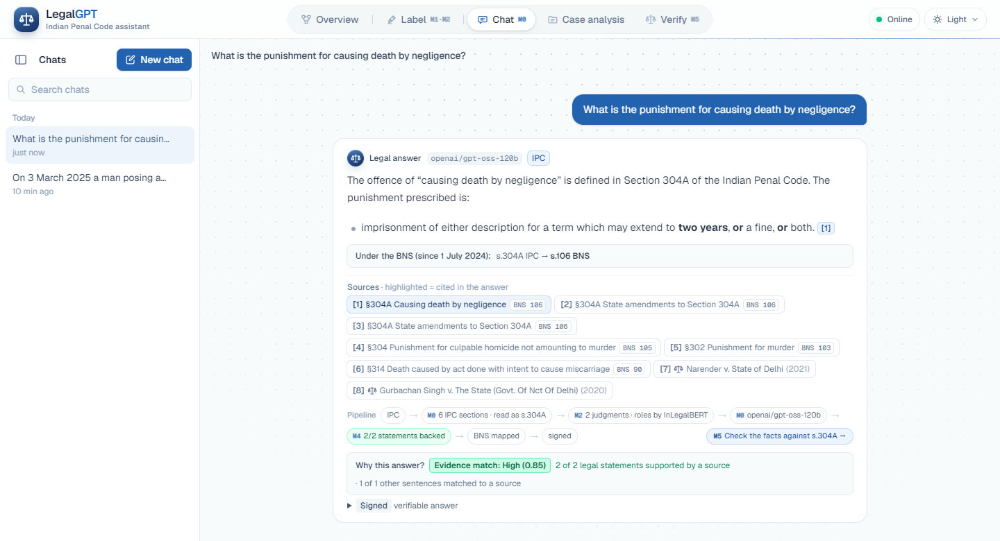
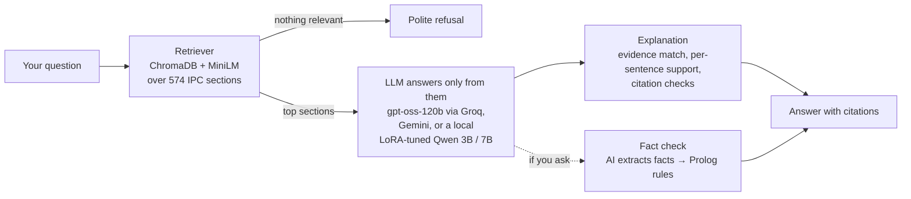

# LegalGPT

**Ask questions about the Indian Penal Code and get answers grounded in the text of the law.**
Every answer cites the sections it used, explains how well they matched your question, and can
check the facts you describe against the legal elements of an offence.

[](https://github.com/bhxvish/legalgpt/actions/workflows/ci.yml)

> ⚖️ **Legal information, not legal advice.** LegalGPT covers the Indian Penal Code, 1860 only.
> The IPC was replaced by the Bharatiya Nyaya Sanhita (BNS) for offences from 1 July 2024.



---

## What it does

| | Feature | In plain words |
|---|---|---|
| 💬 | **Grounded answers** | Finds the relevant IPC sections, answers only from them, and cites each one as `[1]`, `[2]`… Click a citation to read the section. If nothing in the IPC matches, it says so instead of guessing. |
| 🔍 | **"Why this answer?"** | Shows how closely the retrieved law matched your question, which source supports each sentence of the answer, how the sources were chosen (including how everyday words were translated into legal terms), and warns about anything unsupported. |
| ✅ | **Fact check with rules** | Describe a case and pick a section (e.g. 304A). An AI pulls out the facts, each with a quote from your text, and a Prolog rule engine checks them against the section's elements: *consistent*, *inconsistent* or *insufficient facts*. |
| 🏷️ | **Faster dataset building** | An InLegalBERT model suggests the role of every sentence in a judgment (Facts, Argument, Ruling…). People check only the uncertain ones plus random spot checks. **"Why this suggestion?"** highlights the words that drove it (Integrated Gradients), shows how much it relied on the neighbouring sentences, and lists similar sentences people have labelled. |
| 🔐 | **Verifiable results** | Zero-knowledge proofs (EZKL / Halo2) that a fact-check verdict follows from the published rules (the facts stay hidden) and that an answer's sources are exactly what the retrieval rules pick from all 685 sections. Every answer is also signed. [How it works](docs/zk/README.md) |
| 🧪 | **Fine-tuned model comparison** | Switch between a hosted model and a small model fine-tuned on our data (LoRA) to compare their answers side by side. |

## How it works



The research side feeds the app:
**judgments → sentence roles (manual + InLegalBERT-assisted, human-reviewed) → versioned dataset
→ LoRA fine-tuning.**

## Try it

You need [Docker Desktop](https://www.docker.com/products/docker-desktop/) and a free
[Groq API key](https://console.groq.com/keys).

```bash
git clone https://github.com/bhxvish/legalgpt.git
cd legalgpt
cp .env.example .env        # then open .env and paste your key after GROQ_API_KEY=
docker compose up --build
```

Open **http://localhost:5173**. The first build takes about 10 minutes. On first start the backend
also builds its search index from the IPC text in this repo (about a minute; the log says
`index ready: 685 chunks`).

**What works out of the box:** Chat (Legal and General modes), citations, the Why panel, fact
checking and the Verify tab. The annotation data and trained models are not in this repository,
so the **Label** tab starts empty, uploading judgments in the Label tab needs a
trained sentence-role classifier, and the **Local (LoRA)** model is disabled until you train one (see
the [full guide](docs/GUIDE.md)).

Try asking:
- *What is the punishment for causing death by negligence?*
- *What is the difference between culpable homicide and murder?*
- *A lorry driver overtook rashly and killed a motorcyclist. Which section applies?* (then pick
  *Also verify facts against → s.304A*)

## The tabs

| Tab | Who it's for | What you do there |
|---|---|---|
| **Overview** | Everyone | How the parts fit together: the offline lane that builds the knowledge and the online lane every question runs through, with module numbers, live counts and headline results. |
| **Chat** | Everyone | Ask questions. *Legal* mode answers only from the IPC with citations; *General* mode is an ordinary chatbot answer. Past conversations are kept in a history sidebar (saved in your browser) where you can start a new chat or delete old ones. |
| **Label** | Annotators | Upload judgments (.txt or .pdf); InLegalBERT suggests a role for every sentence. You check only the uncertain sentences and a random sample of confident ones (Enter to accept, 1–5 to change, then *Sign off*). Some judgments are labelled blind, with the suggestions hidden: about 1 in 10 uploads (a stable hash of the case id; `REVIEW_BLIND_RATE`), judgments sent back because too many spot checks were wrong, and second labellings for agreement between people. |
| **Case analysis** | Everyone | Upload a case file; facts with quotes, IPC offences, element checks, similar judgments and a cited analysis (never a verdict). |
| **Verify** | Everyone | Paste case facts and check them against one of 7 encoded sections (279, 304A, 304B, 323, 337, 338, 379). |

## Results

All numbers are measured on held-out data; the details are in [PLANNING.md](PLANNING.md). The second
annotation, the answer ratings and the fact-check test set were made by an AI (Claude), not by
lawyers. The reports say exactly what was measured.

| Part | Result |
|---|---|
| **Retrieval** | All 574 sections of the India Code IPC parsed into 685 chunks. The refusal threshold (0.55 cosine similarity) was calibrated on in-scope vs out-of-scope questions. **Everyday questions** ("someone slapped me at the bus stop") find the right section **80%** of the time on held-out questions (was 5%), thanks to a lay-to-legal word list and a "is this about a crime?" check; **0 of 24** civil or off-topic questions are answered. [Report](docs/reports/scenario_retrieval.md) |
| **Sentence-role classifier** (InLegalBERT) | Macro-F1 **0.745 ± 0.021** (5-fold cross-validation over 36 annotated judgments; 0.66 before adding sentence context). At the default confidence bar about a quarter of sentences need a human check (was 44%), and the labels it accepts unchecked are **87%** accurate. |
| **LoRA fine-tuning** (Qwen2.5-1.5B, 4-bit QLoRA) | Adapter v0.4, trained on grounded questions built from the IPC itself: on 41 questions about 29 IPC sections held out of training it answers **100%** and cites the right section **98%** of the time (v0.2: 39% / 39%; it mostly said "I don't know"). v0.4 (re-trained with the same 2 epochs as v0.3, so the comparison is clean) states punishments in plain words ("imprisonment of up to two years, or a fine, or both"), correctly in 12 of 12 cases; questions about what a section provides are still mostly quoted. Runs locally: under a second per answer on the GPU, first words in 6–10 s on CPU. [Report](docs/reports/lora_v0.4_eval.md) |
| **Fact verification** | 7 IPC sections encoded as element checklists in Prolog; each extracted fact must quote the user's text, and extraction runs twice to keep only stable answers. On the 15 original test fact patterns it gave the expected verdict 13 times. After a quoting fix for date-based facts, the 2 misses and **8 new cases** all pass (10/10); across all **23 cases it is right 22 times**. The one miss (v06) is a wrong verdict: the AI reads "the car hit a wall" as a pure accident, with the old prompt too. [Report](docs/reports/verification_eval.md) |
| **Zero-knowledge proofs** | Verdict proof in about **1 s** (33 KB, verifies in 0.03 s); retrieval proof over all 685 chunks in about **8 s** (196 KB, verifies in 0.1 s). On 315 fact sets the proof circuit gives exactly the Prolog engine's verdicts. [Details](docs/zk/README.md) |
| **Blind answer rating** | 20 questions, each answer rated 1–5 for relevance, groundedness and completeness without knowing which model wrote it: hosted model **4.75**, tuned LoRA **4.53**. [Report](docs/reports/blind_eval_v0.3.md) |
| **Dataset** | Corpus v0.3: 36 judgments, 5,602 labelled sentences. Labelling agreement with an independent second annotation **κ = 0.91** (5 cases). [Report](docs/reports/annotation_agreement_v0.3.md) |

## Run without Docker

You need Python 3.11, Node.js 20+ and [SWI-Prolog](https://www.swi-prolog.org/download/stable)
(for fact checking).

```bash
python -m venv .venv
.venv/Scripts/pip install -r backend/requirements.txt      # Windows (macOS/Linux: .venv/bin/pip)
.venv/Scripts/python -m uvicorn app.main:app --app-dir backend --port 8000
```

In a second terminal:

```bash
npm --prefix frontend install
npm --prefix frontend run dev
```

**Zero-knowledge proofs (optional):** `pip install -r backend/requirements-zk.txt`, then
`python backend/scripts/zk_setup.py` once (about a minute; writes 1.3 GB of proving keys to `data/zk/`).
Without it, answers are still signed but the proof buttons stay hidden. See [docs/zk](docs/zk/README.md).

**Tests:** `pytest -m "not integration"` (the same command CI runs; no network or API key needed).
**Demo:** with the app running, `python backend/scripts/demo.py` sends five questions through the
whole pipeline and prints a summary.

## Project layout

```text
backend/app/core/                 retrieval, prompts, chat API, LLM clients
backend/app/annotation/           judgment collection, sentence splitting, label scheme, annotation store
backend/app/labeling_assistant/   InLegalBERT classifier, review queue
backend/app/finetuning/           LoRA training data, trainer, model comparison
backend/app/explainability/       evidence match, citation checks, sentence attribution
backend/app/verification/         fact extraction + Prolog rules (rules/*.pl)
backend/app/zk/                   zero-knowledge proofs (EZKL), commitments, signed answers
backend/scripts/                  command-line tools (ingest, train, review, demo…)
frontend/                         React + Tailwind web app
data/corpus/ipc_chunks.jsonl      the parsed IPC (public domain)
docs/                             full guide, annotation guideline, reports
```

## Limitations

- **IPC only**, and only the bare act: no case law, no CrPC or Evidence Act. Offences after 1 July
  2024 fall under the BNS, which is not covered.
- **"Evidence match" is not correctness.** It says how well the retrieved law matches the question,
  not whether the answer is right.
- **Small dataset:** 36 judgments. Agreement was measured against an AI second annotator, not
  between two people.
- **The fact check is only as good as the extracted facts**, and covers 7 sections without
  exceptions or general defences.
- **No login or rate limiting:** run it locally or behind your own access control.

The full list is in [PLANNING.md → Known limitations](PLANNING.md#known-limitations).

## Future work

- **BNS coverage**, with a mapping from IPC to BNS sections; judgments as a second source.
- **More Prolog sections**, including exceptions and general defences.
- **Human double annotation and expert ratings** (the current agreement and answer ratings use an
  AI annotator and judge); human-written answers for LoRA training.
- **ZKML for the language models themselves.** The fact check and retrieval are proved, and
  answers are signed. Proving a 1.5B+ model's forward pass is still far too slow on this hardware,
  and it would prove *which model ran*, not that the legal answer is right.

## Documentation

- [Full guide](docs/GUIDE.md): every module, script, setting and API endpoint
- [PLANNING.md](PLANNING.md): design decisions, measured results and known limitations, phase by phase
- [Annotation guideline](docs/annotation_guideline.md): how to label sentence roles
- [Verifiable results (ZKML)](docs/zk/README.md): what is proved, what is not, and how to check a proof
- Reports: [LoRA v0.3 on held-out sections](docs/reports/lora_v0.3_ipc_eval.md),
  [blind answer rating](docs/reports/blind_eval_v0.3.md),
  [fact-check test set](docs/reports/verification_eval.md),
  [annotation agreement](docs/reports/annotation_agreement_v0.3.md),
  [LoRA v0.2 comparison](docs/reports/lora_v0.2_comparison.md)

## Acknowledgements

- [law-ai/InLegalBERT](https://huggingface.co/law-ai/InLegalBERT) for the legal-domain BERT model
- [Qwen2.5-1.5B-Instruct](https://huggingface.co/Qwen/Qwen2.5-1.5B-Instruct) and
  [gpt-oss-120b](https://huggingface.co/openai/gpt-oss-120b) (served by [Groq](https://groq.com))
- [all-MiniLM-L6-v2](https://huggingface.co/sentence-transformers/all-MiniLM-L6-v2) for embeddings
- [India Code](https://www.indiacode.nic.in/) for the bare act text
- Supreme Court judgments from the CC-BY-4.0 dataset
  [labofsahil/Indian-Supreme-Court-Judgments](https://huggingface.co/datasets/labofsahil/Indian-Supreme-Court-Judgments)
