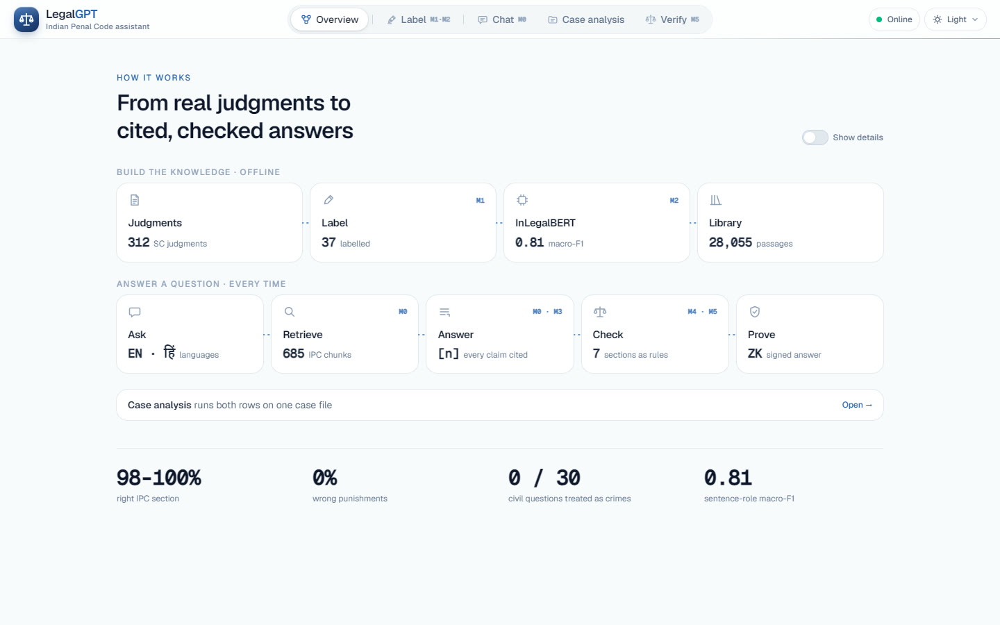
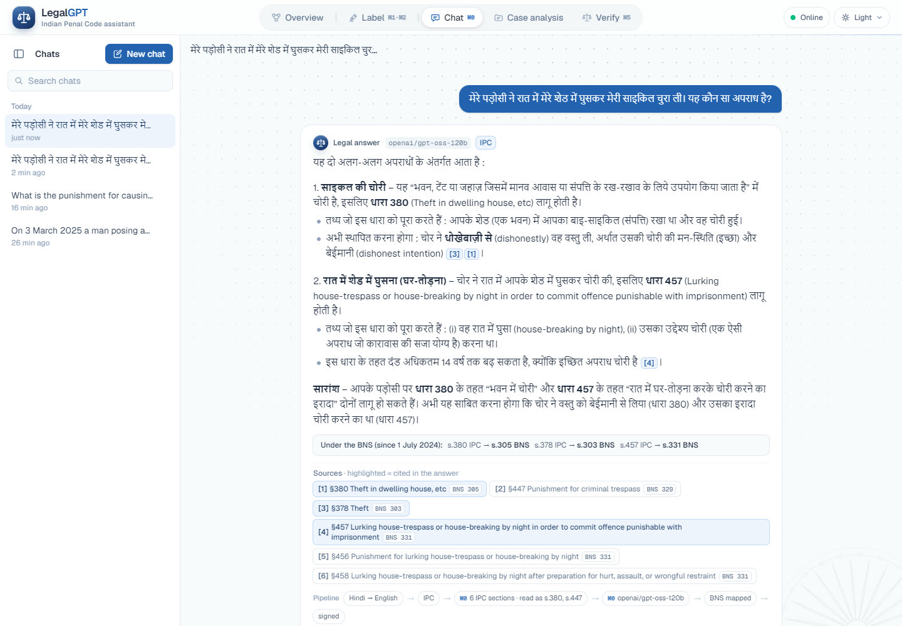
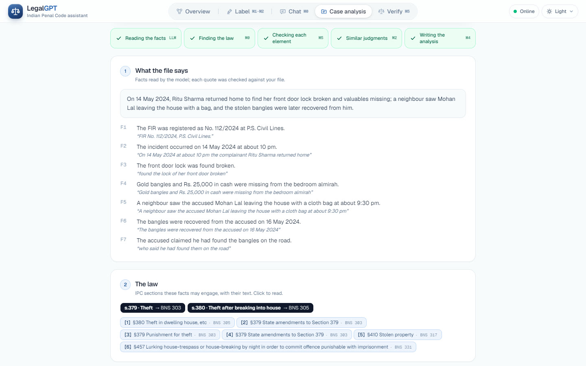
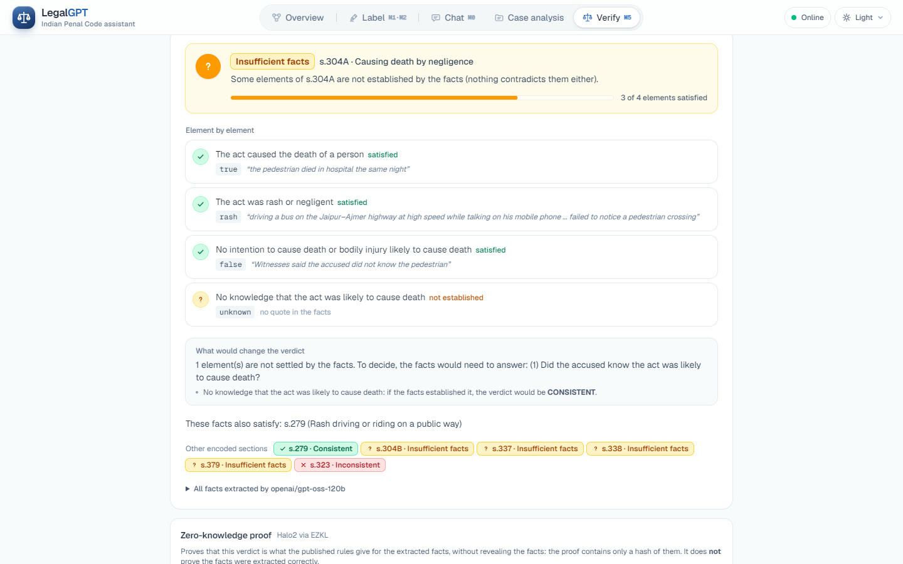
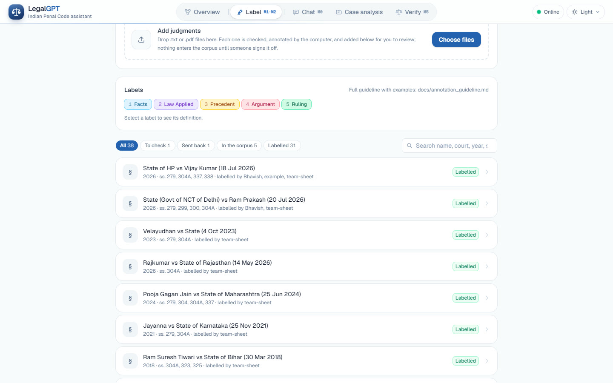
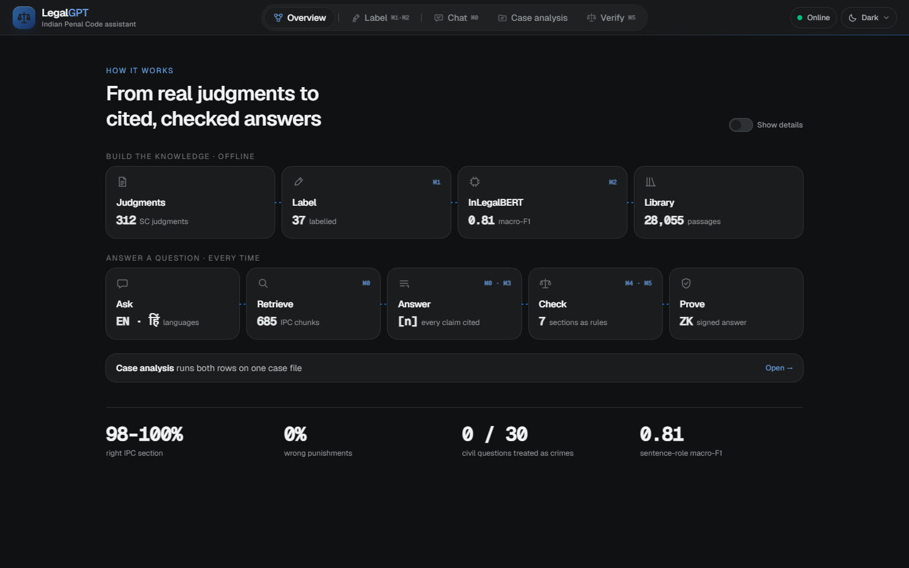
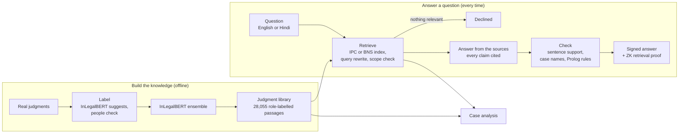

# LegalGPT

**A research system for Indian criminal law whose claims are measured, not asserted.**
Ask about an offence in English or Hindi and get an answer written only from the text of the law:
the Indian Penal Code, 1860 or the Bharatiya Nyaya Sanhita, 2023. Every claim is cited, real Supreme
Court judgments are cited next to the statute, and each answer shows the pipeline it went through,
is checked sentence by sentence and is signed. Upload a case file and get a structured, cited
analysis: never a verdict.

[](https://github.com/bhxvish/legalgpt/actions/workflows/ci.yml)

> **Legal information, not legal advice.** LegalGPT covers substantive offences under the IPC
> (offences before 1 July 2024) and the BNS (from 1 July 2024). It declines civil matters, criminal
> procedure (CrPC/BNSS) and special Acts such as the UAPA or NDPS Act, and it never says whether
> anyone is guilty.



---

## Contents

- [What it does](#what-it-does)
- [Screenshots](#screenshots)
- [How it works](#how-it-works)
- [Results](#results)
- [Try it](#try-it)
- [The tabs](#the-tabs)
- [Reproduce the results](#reproduce-the-results)
- [Run without Docker](#run-without-docker)
- [Project layout](#project-layout)
- [Limitations](#limitations)
- [Documentation](#documentation)

## What it does

| Feature | Description |
|---|---|
| **Grounded, cited answers** | Retrieves the relevant sections and answers only from them, citing each as `[1]`, `[2]`… Questions outside the indexed law are declined instead of guessed. |
| **IPC and BNS** | A **Law** switch: *Auto* answers under the BNS when you name it or the events are on or after 1 July 2024, otherwise under the IPC. IPC sources show their BNS number and BNS sources the IPC sections they replaced, from the official BPRD correspondence table. |
| **Hindi** | Ask in Hindi: the question is searched in English translation and answered in Hindi with the same citations. If no model can translate (free quotas), it says so instead of guessing. |
| **Real judgments** | 349 judgments (312 Supreme Court criminal judgments, 2020–2023, plus 37 annotated) split into 28,055 passages labelled by role. The chat cites rulings and precedents next to the statute; the citation check warns when a sentence names a different case than the one it cites. |
| **Case analysis** | Upload an FIR, charge sheet or case note: facts (each checked against a quote from the file), the offences they may engage, an element-by-element check (Prolog rules where encoded), similar past judgments, and a cited analysis. An output guard (patterns plus a small classifier) removes any sentence that states a verdict; prompt-injection defences treat the file as untrusted data. |
| **"Why this answer?" and the pipeline trace** | Each answer shows the stages it went through (translation, sections retrieved, judgments, model, statements backed, BNS, signature), how closely each sentence is supported by a source, and any warnings. |
| **Fact check with rules** | Describe a case and pick a section: an AI extracts the facts, each with a quote, and a Prolog engine checks them against the section's elements. Opens pre-filled from a chat answer. |
| **Labelling with InLegalBERT** | Upload judgments; an InLegalBERT ensemble suggests a role for every sentence (Facts, Law Applied, Precedent, Argument, Ruling). People check only the uncertain ones; 1 judgment in 10 is labelled blind to keep measuring the model. |
| **Verifiable results** | Every answer is signed (Ed25519); zero-knowledge proofs (EZKL) show that a fact-check verdict follows from the published rules and that an answer's IPC sources are exactly what retrieval picks. [How it works](docs/zk/README.md) |
| **Models** | Groq (gpt-oss-120b, default) and Gemini on free tiers, local LoRA-tuned Qwen models via llama.cpp (fully offline), and optional paid GPT models. Paid models are never used as fallbacks. |

## Screenshots

**A cited answer.** Every claim cites its source, the line under the answer gives the BNS equivalent,
judgments are cited next to the statute, and the pipeline trace shows each stage the answer went
through.


**A question in Hindi.** The question is searched in English translation and answered in Hindi with
the same citations; the trace starts with the translation step.



**Case analysis.** Facts are read from the file, each with a quote that is checked against it, and the
offences they may engage are listed with their BNS numbers, followed by element checks, similar
judgments and a cited analysis.



**Rule-based fact check.** The facts are tested element by element against a section encoded in
Prolog; each element shows the quote it rests on, and the panel says what would change the verdict.



**Labelling.** Judgments are labelled with InLegalBERT's help; the list shows what each judgment still
needs and who labelled it.



The interface has light and dark themes, with three dark styles.



## How it works



The app's **Overview** tab shows the same two lanes, with live counts and the headline results.

## Results

All numbers are on held-out data, reproducible with one command ([below](#reproduce-the-results)),
and explained in [docs/reports/paper_analysis.md](docs/reports/paper_analysis.md). Answers come from
free tiers (Groq, Gemini); paired comparisons are each model against itself answering alone.

**Headline (LegalGPT vs the same model alone, 3 models)**

| Measure | Model alone | LegalGPT |
|---|---|---|
| Right section on statute questions | 41–81% | **98–100%** (p ≤ 0.002) |
| Wrong punishments stated | 15–54% | **0%** |
| Civil questions answered as an offence | 14–27 of 30 | **0 of 30** |
| Everyday scenarios: acceptable section | 78–85% | 82–93% |

**Components**

| Part | Result |
|---|---|
| **Sentence roles** (InLegalBERT ensemble) | Macro-F1 **0.807** (5-fold CV by judgment) vs 0.667 sentence-only; McNemar p = 3e-21; the gain holds on human-labelled judgments alone (0.752 → 0.813). |
| **BNS answering** | Right BNS section retrieved for **53/60** held-out scenarios, the same as under the IPC; 0/30 out-of-scope answered. 358/358 BNS sections indexed from India Code. |
| **Hindi** | Right section retrieved **52/60** (English 53/60; 0/60 without translation). End to end: 56/60 answered, all in Hindi, **51/60** cite an acceptable section; 30/30 out-of-scope declined in Hindi. |
| **Case analysis** (120 real SC judgments, sections masked) | At least one correct offence named **65%**; the most similar judgment shares an offence 68%. |
| **Prompt injection** (24 attack files) | Attacks that worked: 1/24 without the defences, **0/24** with them. Worst case (a model obeying every attack): the output guard removes **192/192** verdict and **144/144** fake-law sentences, and no genuine one. |
| **Verdict guard** | Paraphrased verdicts caught **93%** (patterns alone 18%), on sentences from a different model family than training; 0/100 real analysis sentences removed. |
| **Judgment-citation faithfulness** | Two independent AI judges: both say SUPPORTED for 14/19 judgment citations, none UNSUPPORTED; κ = 0.72. A blind human spot-check found **0 unsupported** of 38 and showed the judges to be stricter than the human. |
| **IPC → BNS map** | 527 IPC sections mapped from the official BPRD table; all 47 entries of the earlier unverified map agree. |

**Provenance of the data:** several ground truths were made with AI help and are labelled as such:
the benchmark's scenario answers, 529 sentence-role labels, the machine-translated Hindi questions,
the verdict-guard sentences and the faithfulness judgements. A human spot-check of the AI judges is in
[benchmark/spotcheck](benchmark/spotcheck/README.md).

## Try it

You need [Docker Desktop](https://www.docker.com/products/docker-desktop/) and a free
[Groq API key](https://console.groq.com/keys) (a free [Gemini key](https://aistudio.google.com/apikey)
is a useful second model).

```bash
git clone https://github.com/bhxvish/legalgpt.git
cd legalgpt
cp .env.example .env        # then open .env and paste your key after GROQ_API_KEY=
docker compose up --build
```

Open **http://localhost:5173**. The first build takes about 10 minutes. On first start the backend
builds its search indexes from the IPC and BNS text in this repository (a minute or two; the log says
`index ready`).

**Works out of the box:** Overview, Chat (IPC and BNS, English and Hindi), citations, the Why panel
and trace, Case analysis, and Verify. **Needs extra data:** judgment citations and similar judgments
need the judgment library (`backend/scripts/fetch_sc_judgments.py` and `build_judgment_index.py`,
see the [guide](docs/GUIDE.md)); the Label tab needs a trained sentence-role classifier; the
**Local (LoRA)** model needs a trained adapter.

Try asking:
- *What is the punishment for causing death by negligence?*
- *On 3 March 2025 a man posing as a bank officer took my OTP and emptied my account. Which offence is this?* (answered under the BNS)
- *मेरे पड़ोसी ने रात में मेरे शेड में घुसकर मेरी साइकिल चुरा ली। यह कौन सा अपराध है?*
- *My landlord won't return my security deposit.* (declined: a civil matter)

## The tabs

| Tab | What you do there |
|---|---|
| **Overview** | The whole system on one screen: how the knowledge is built and what every question runs through, with one number per stage and four headline results (*Show details* for more). |
| **Label** | Upload judgments (.txt or .pdf); InLegalBERT suggests a role for every sentence. Check the uncertain sentences and a few spot checks (Enter accepts, 1–5 changes, then *Sign off*). Blind samples, judgments sent back from review and second labellings open with the suggestions hidden. |
| **Chat** | *Legal* mode answers only from the law with citations; *General* mode is an ordinary chatbot answer. **Law:** Auto / IPC / BNS. Pick the model under the box. History is kept in your browser. |
| **Case analysis** | Upload or paste a case file. Facts with quotes, offences (with BNS numbers), element checks, similar judgments and a cited analysis; *Keep the file on this computer* runs everything on the local model. |
| **Verify** | Check stated facts against one of 7 IPC sections encoded as Prolog rules (279, 304A, 304B, 323, 337, 338, 379). |

## Reproduce the results

One command rebuilds every table of the paper analysis from the saved results, with no model calls
(API keys are replaced by an invalid placeholder for the run, so an incomplete cache fails instead of
calling a model or spending money):

```bash
python backend/scripts/reproduce.py
```

It writes [docs/reports/reproduced.md](docs/reports/reproduced.md): each step's command, status and
output (13 steps: paired tests, classifier CV, Hindi, injection, output guard, verdict classifier,
faithfulness, case analysis, BNS map, BNS answering, blind samples). The cached inputs live in
`data/reports/` and `data/models/rrl_cv/`, which are not in git; a step whose inputs are missing is
skipped and listed. Re-running an evaluation from scratch uses the scripts in
`backend/scripts/eval_*.py`, which need API keys and free-tier quota.

## Run without Docker

You need Python 3.11, Node.js 20+ and [SWI-Prolog](https://www.swi-prolog.org/download/stable)
(for fact checking).

```bash
python -m venv .venv
.venv/Scripts/pip install -r backend/requirements.txt      # Windows (macOS/Linux: .venv/bin/pip)
.venv/Scripts/python -m uvicorn app.main:app --app-dir backend --port 8000
```

In a second terminal:

```bash
npm --prefix frontend install
npm --prefix frontend run dev
```

**Optional:**
- **Zero-knowledge proofs:** `pip install -r backend/requirements-zk.txt`, then
  `python backend/scripts/zk_setup.py` once (writes 1.3 GB of proving keys to `data/zk/`). Without
  it, answers are still signed.
- **Local models:** `llama-cpp-python` and GGUF files (see the [guide](docs/GUIDE.md)); set
  `OFFLINE_MODE=true` to send nothing to a hosted model.
- **More models:** `EXTRA_MODELS=gemini:gemini-3.5-flash-lite,openai:gpt-5.4-mini` in `.env`.

**Tests:** `pytest -m "not integration"` (what CI runs; no network or API key needed).
**Demo:** with the app running, `python backend/scripts/demo.py` sends five questions through the
whole pipeline.

## Project layout

```text
backend/app/core/                 retrieval (IPC + BNS), prompts, chat API, LLM clients, Hindi, BNS map
backend/app/case_analysis/        case-file analysis, output guard, verdict classifier
backend/app/judgments/            judgment library search and citations
backend/app/annotation/           judgment collection, sentence splitting, label store
backend/app/labeling_assistant/   InLegalBERT ensemble, review queue, blind samples
backend/app/explainability/       evidence match, citation and case-name checks, attribution
backend/app/verification/         fact extraction + Prolog rules (rules/*.pl)
backend/app/zk/                   zero-knowledge proofs (EZKL), signed answers
backend/app/finetuning/           LoRA training data and trainer
backend/scripts/                  ingest, evaluate (eval_*.py), reproduce, spot-check, train
frontend/                         React + Tailwind web app
data/corpus/                      parsed IPC and BNS (public domain)
benchmark/                        questions, Hindi set, verdict-guard set, human spot-check
docs/                             guide, annotation guideline, paper analysis, reports
```

## Limitations

- **Scope:** substantive offences under the IPC and BNS only. No procedure (CrPC/BNSS), evidence
  law or special Acts; these are declined.
- **AI-assisted ground truth:** several datasets and judgements were made with AI help (see
  [Results](#results)). A human spot-check by one non-expert supports them, but no lawyer has
  reviewed them.
- **Small samples:** 60 scenarios, 24 injection files and 19 judgment citations; confidence
  intervals are reported and wide.
- **Case analysis names a correct offence 65% of the time:** an assistive draft, never a decision.
- **"Evidence match" is not correctness:** it says how well the retrieved law matches the
  question, not whether the answer is right.
- **Retrieval proofs cover the IPC index;** BNS answers are signed but not proved. The Prolog rules
  encode IPC sections (a BNS answer is checked through the section it replaced).
- **Sentence-level support is measured for English answers only** (the embedding model is English);
  Hindi answers keep their citation and case-name checks.
- **Free tiers:** daily quotas run out; the app says so, and the local model keeps working.
- **No login or rate limiting:** run it locally or behind your own access control.

## Documentation

- [Paper analysis](docs/reports/paper_analysis.md): every result, how it was measured, its limits
- [Reproduced results](docs/reports/reproduced.md): the output of `reproduce.py`
- [Full guide](docs/GUIDE.md): every module, script, setting and API endpoint
- [PLANNING.md](PLANNING.md): design decisions phase by phase
- [Annotation guideline](docs/annotation_guideline.md): how to label sentence roles
- [Verifiable results (ZKML)](docs/zk/README.md): what is proved, what is not, how to check a proof
- [Human spot-check](benchmark/spotcheck/README.md): the blind human labels against the AI judges

## Acknowledgements

- [law-ai/InLegalBERT](https://huggingface.co/law-ai/InLegalBERT) for the legal-domain BERT model
- [gpt-oss-120b](https://huggingface.co/openai/gpt-oss-120b) (served by [Groq](https://groq.com)),
  Google Gemini, and [Qwen2.5](https://huggingface.co/Qwen) for the local LoRA models
- [all-MiniLM-L6-v2](https://huggingface.co/sentence-transformers/all-MiniLM-L6-v2) for embeddings
- [India Code](https://www.indiacode.nic.in/) for the IPC and BNS bare acts
- The Bureau of Police Research and Development (Ministry of Home Affairs) for the IPC–BNS
  correspondence table
- Supreme Court judgments from the CC-BY-4.0 dataset
  [labofsahil/Indian-Supreme-Court-Judgments](https://huggingface.co/datasets/labofsahil/Indian-Supreme-Court-Judgments)
